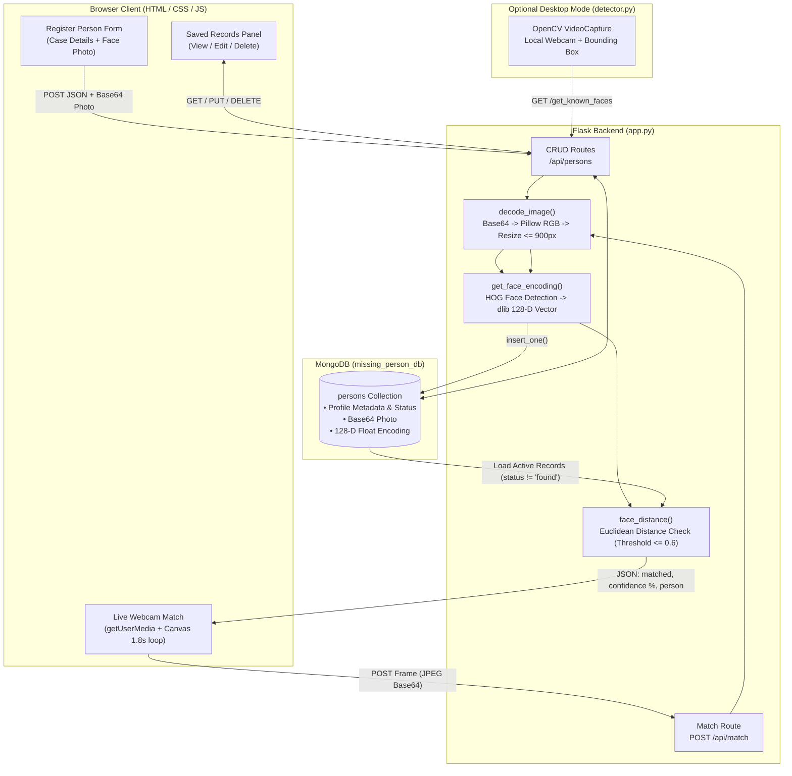
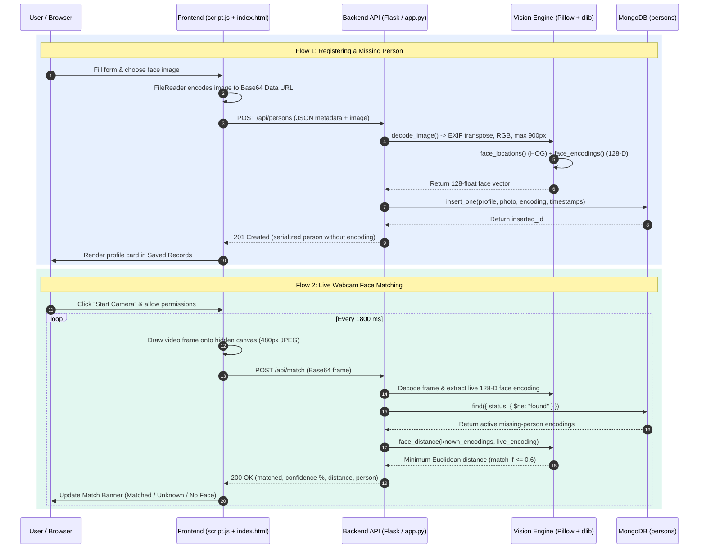

# Missing Person Detector

A full-stack AI application that registers missing-person profiles, stores facial encodings in MongoDB, and matches live webcam frames against active records using OpenCV, dlib, and face_recognition.

## Features

- Browser-based missing-person registration with image preview and case metadata.
- MongoDB-backed profile management for viewing, editing, deleting, and updating case status.
- Flask REST API for person records and real-time face matching.
- Live webcam matching in the web app through `navigator.mediaDevices.getUserMedia`.
- Optional OpenCV desktop detector in `detector.py` for two-terminal demos.

## Tech Stack

- **Backend**: Python 3.12, Flask, REST API
- **Computer Vision / AI**: OpenCV, dlib, `face_recognition`, Pillow, NumPy
- **Database**: MongoDB Atlas or local MongoDB (PyMongo)
- **Frontend**: Vanilla HTML5, CSS3, JavaScript (WebRTC `getUserMedia` + Canvas API)

---

## Architecture Diagrams

### 1. System Architecture (How the Project Works)



### 2. Frontend & Backend Interaction Flow



---

## Setup

### 1. Create and Activate a Virtual Environment

**macOS / Linux:**
```bash
uv venv
source .venv/bin/activate
```
*(Or using standard Python: `python3 -m venv .venv && source .venv/bin/activate`)*

**Windows:**
```powershell
python -m venv .venv
.venv\Scripts\activate
```

### 2. Install Dependencies

**macOS (Apple Silicon):**
Requires `cmake` (`brew install cmake`) for `dlib`. Disable dlib's legacy bundled PNG loader on modern macOS SDKs:
```bash
CMAKE_ARGS="-DDLIB_PNG_SUPPORT=OFF" uv pip install -r requirements.txt
```

**Windows / Linux:**
```bash
pip install -r requirements.txt
```
*(On Windows, `dlib` requires CMake and Visual Studio C++ Build Tools. If installation fails, install a Python-version-compatible `dlib` wheel first, then rerun `pip install -r requirements.txt`.)*

### 3. Configure MongoDB

```bash
cp .env.example .env
```
*(On Windows CMD, use `copy .env.example .env`)*

For MongoDB Atlas, edit `.env` and set `MONGO_URI` to your Atlas connection string. For local MongoDB (native or via Docker on port `27017`), the default `.env` URI works out of the box.

---

## Run The Web App

```bash
python app.py
```

Open `http://127.0.0.1:5000` in a browser.

> **macOS Note:** macOS enables **AirPlay Receiver** on port `5000` by default. If you see `Address already in use`, disable **AirPlay Receiver** in **System Settings → General → AirDrop & AirPlay**.

Recommended demo flow:

1. Register a missing-person profile with a clear face image.
2. Confirm the record appears in **Saved Records**.
3. Start the webcam in **Live Webcam Match**.
4. Observe matched, unknown, and no-face states from the browser.

## Optional Desktop Detector

Start the Flask app first, then run:

```bash
python detector.py
```

The detector uses `API_BASE_URL` and `MATCH_THRESHOLD` from `.env`. Press `q` to close the OpenCV window.

## API Summary

- `POST /api/persons` - create a missing-person record with profile fields and image.
- `GET /api/persons` - list saved records without raw face encodings.
- `GET /api/persons/<id>` - fetch one record.
- `PUT /api/persons/<id>` - update profile metadata, status, and optionally face image.
- `DELETE /api/persons/<id>` - delete one record.
- `POST /api/match` - match a base64 webcam frame against active missing-person records.

Legacy endpoints `/add_person` and `/get_known_faces` remain available for older scripts.

## Tests

```bash
python -m pytest
```

The tests use mocked face-recognition behavior and an in-memory collection, so they do not require a live MongoDB server or webcam.
